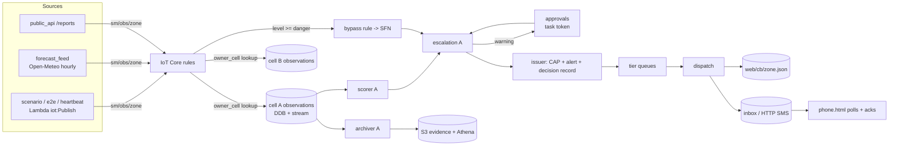

# SentinelMesh: Round 2 gap analysis and implementation plan

Team TheByteForce · Beauty of Cloud 2.0 · Scenario 1 (Disaster Early Warning)
Prepared 2026-10-08 from a full read of this repository (`main` = `Himeth_v1` = `origin/main` @ `f7d4c08`), the Round 1 proposal and the delegate booklet.

---

## Implementation status (2026-10-09, branch `Himeth_v1`)

Done, one commit each. Verified locally with ruff, `terraform fmt -check` and `validate` (Terraform 1.16.5, the CI version), 239 unit tests with moto, and 13 Node tests of the web pages. **Not yet verified against AWS:** the E2E, load and GameDay jobs need a deploy from `main`.

| Item | Status |
|---|---|
| D1 heartbeat alerts issued as Actual / officer email spam | done; test zones are always Test, no officer email, hidden from console lists |
| D2 stale warning sent after imminent | done; StillCurrent re-check, `superseded` record, approval settled; E2E added |
| D3 enqueue failure silent; issuer retries duplicate alerts | done; EnqueueFailed path; issuer idempotent per execution |
| D4/D5 dispatch not idempotent / not scalable | done; planner, then batched send queues, then senders, with a delivery ledger |
| D6 phone ignores cell broadcast | done; broadcast-only mode, both channels, one pop-up per alert |
| D7 only cell A heartbeat | done; H00/H01/H02, per-zone alarms |
| D8 forecast window / nulls | done |
| D9 deploy role could rewrite its boundary; bootstrap order | done; explicit denies; bootstrap can run first (**needs an admin bootstrap apply to take effect**) |
| D10 configure-secrets job missing | done |
| D11 real SMS impossible | done; verified opt-in (W8.4) + EUM (W4.3) |
| D12 blind-zone metric polluted | done; burst test cleans up and enforces a latency limit |
| D13 coverage hid handlers | done (all handlers measured) |
| D14 logs kept forever | done; 14 days |
| D15 archiver dropped evidence | done; DLQ + alarm |
| D16 smaller issues | done: pepper in Secrets Manager, README; DLR `?k=` kept but query strings redacted in WAF logs |
| W2 device identity | done: things, certificates, pinned policy, certificate-based routing, revocation variable, field station simulator (no QC; see below) |
| W3 broadcast, public map, all-clear, CAP feed | done |
| W4 fan-out, ledger, EUM SMS + receipts | done (`TF_VAR_sms_provider=eum`; sandbox numbers are a manual step) |
| W5 Local Alert Node | done: bundles, node identities and role alias, node program, LAN SMS gateway, local broadcast, chained uploads |
| W6 standby cell C, heartbeats, GameDay | done (in-flight approval adoption and the health-driven recommendation are not built) |
| W7 reach monitoring | done: delivery rate, composite "people may be uncovered" alarm, system-health alarms, dashboard v2, WAF logging |
| W8 security | done: agency roles, decision hash chain + verifier, opt-in/consent/unsubscribe, S3 lifecycle, security headers (SOS, MFA ON, SRI, CloudTrail not built) |
| W11 tests and tools | done: handler tests, ASL tests, web tests, replay tool, dispatch load test |
| W12 CI | done: web-tests, secret detection, configure-secrets, verify-decisions, gameday jobs |
| Not built (P2) | plausibility QC (W2.5), Device Defender, GloFAS/satellite source (W9), server-side geohash to zone (W10), SOS (W8.7), tilt bypass, inbound SMS reports, Round 2 documents and deck (W14) |

---

## 0. Summary

**Where we are.** The prototype is much further along than most Round 2 entries will be. It's a real, CI-deployed AWS stack with:
- two detection/delivery cells,
- corroboration scoring with unit tests,
- a Step Functions escalation workflow with fail-toward-alerting approvals,
- an IoT hard-threshold bypass,
- CAP 1.2 output, trilingual one-segment SMS templates and a simulated phone,
- an officer console with Cognito, WAF and per-group field filtering,
- reach-based monitoring (heartbeat, TTFA) and an Athena evidence lake,
- six live end-to-end "proof moment" tests.

**What's missing.** It falls into four groups:

1. **Correctness bugs** (section 3). The most serious ones:
   - Heartbeat alerts are very likely issued as CAP `Actual` alerts and emailed to officers every 10 minutes (D1).
   - A warning waiting for approval can be issued *after* an imminent alert for the same zone (D2).
   - Dispatch is neither idempotent nor scalable (D4, D5).
   - The phone never reads the cell-broadcast stand-in (D6).
   - The deploy role can rewrite its own permissions boundary (D9).
2. **Proposal claims with no implementation** (section 2):
   - the no-cloud Local Alert Node,
   - the warm standby cell,
   - per-device X.509 identity,
   - all-clear / CAP updates,
   - the agency roles (met, EMS, NGO),
   - SOS,
   - a satellite / independent model source,
   - a delivery-rate alarm,
   - a cached public map.
3. **Proposal claims that must be revised, not built**, because of account limits or new AWS facts:
   - Pinpoint support ends 2026-10-30, so we move to AWS End User Messaging SMS.
   - Snowball Edge is closed to new customers, so the edge node becomes Greengrass on a commodity box.
   - Route 53 ARC costs about $1,825 per month for one cluster.
   - Kinesis and Flink are blocked in our account.
   - Object Lock and customer-managed KMS keys are forbidden by account rules.
   - Our account can only use one region.
4. **Round 2 deliverables**, none of which exist yet:
   - pitch deck,
   - architecture documentation,
   - security & scalability plan,
   - implementation roadmap,
   - demo video,
   - a real cost model (the Round 1 "$500/month" is not credible).

**The ten things that matter most**, in order:

| # | Item | Why | Ref |
|---|---|---|---|
| 1 | Fix heartbeat-as-Actual + officer email spam | A judge opening the console sees fake "Actual" alerts every 10 min | D1 |
| 2 | Superseded-warning check in the workflow | Sending "prepare to evacuate" after "move NOW" is a safety bug | D2 |
| 3 | Phone reads cell broadcast without sign-up | Proves the proposal's core claim "CB needs no subscription" | D6, W3 |
| 4 | Local Alert Node + "cut the cloud" demo | The headline differentiator in Fig 1b and Fig 2; nothing exists yet | W5 |
| 5 | Cell C warm standby + per-cell heartbeat | Proposal says "two active cells + warm standby"; the prototype has no standby | W6, D7 |
| 6 | Dispatch fan-out, idempotency, delivery ledger, delivery-rate alarm | Scalability (25%) and monitoring (15%) | W4, W7 |
| 7 | Boundary privilege-escalation fix + bootstrap ordering | Security (15%); judges may read the IaC | D9 |
| 8 | Real cost model (fixed vs per-event) | Cost (15%) is currently the weakest section | W13 |
| 9 | Proposal corrections (EUM, edge, ARC, Kinesis/Flink, Object Lock) as an explicit "prototype vs production" mapping | Turns account limits into deliberate, explained trade-offs | §2, W14 |
| 10 | Deck, architecture doc, security & scalability plan, roadmap, demo video | Required Round 2 submissions | W14 |

---

## 1. Current state (verified)

### 1.1 What was checked on 2026-10-08

| Check | Result |
|---|---|
| `ruff check services tests scripts` (ruff 0.14.0, the CI pin) | **Pass** |
| `pytest tests/unit` | **49 passed** |
| Coverage as reported (`--cov=services`) | 74%, **but misleading**: only `services/common/*` is measured. No handler is imported by any test, and the handler folders have no `__init__.py`, so coverage never sees them (see D13). |
| `scripts/gen_zones.py` re-run | Deterministic; no diff against the committed `zones.json` / `zones.geojson` |
| `terraform fmt/validate` | **Not run locally** (Terraform isn't installed here). CI's `tf-lint` job covers it. |
| E2E and load tests | **Not run** (they need the deployed stack and AWS credentials). They run in CI after `apply`. |
| Git | Clean working tree; `Himeth_v1`, `main` and `origin/main` all point to `f7d4c08`. All 52 commits are dated 2026-10-07. |

### 1.2 Inventory

| Area | What exists |
|---|---|
| Account constraints (README + code comments) | Region `ap-southeast-2` only (org policy). **Kinesis is blocked.** No Object Lock, no customer-managed KMS, no PITR, nothing retained after `terraform destroy`. |
| CI/CD (`.gitlab-ci.yml`) | lint → test → plan → apply/destroy → e2e / load / verify-teardown. GitLab-managed state, SAST-IaC, protected credentials on `main` only. |
| Bootstrap (`terraform/bootstrap`) | CI IAM user that can only assume the deploy role. The deploy role has PowerUserAccess plus scoped IAM, and it may only create roles that carry the workload boundary. |
| Shared module | Tables: `zones`, `zone-state`, `alerts` (GSI by-day), `approvals` (sparse GSI pending), `subscribers` (GSI by-zone), `inbox` (TTL), `ratelimits` (TTL). Buckets: `evidence`, `decisions` (write-once policy) and `web` (private, CloudFront OAC). |
| Cell module ×2 (a, b) | Observations table + stream (the stand-in for Kinesis), IoT routing rule (owner lookup = failover as data), scorer Lambda (stream + 1-min watchdog), archiver Lambda (to S3), Step Functions escalation, three tier queues + DLQ, issuer, dispatch, IoT hard-threshold bypass rule. |
| Shared services | `approvals`, `public_api`, `console_api`, `scenario` (4 drills), `heartbeat` (10 min, full path), `forecast_feed` (Open-Meteo, hourly). |
| Edge | REST API from generated OpenAPI, 13 routes, Cognito authorizer, WAF (common, bad-inputs, reports 10/min/IP, overall 3000/5min). CloudFront for web and CAP. |
| Ops | Alarms: heartbeat (cell a only), dispatch DLQ per cell, TTFA p95 > 90 s. Dashboard (6 widgets), $30 budget, Glue/Athena replay table. |
| Web | Officer console (Leaflet map, tier gauge, evidence bars, approvals countdown, drills, failover A→B). Simulated phone (opt-in, trilingual full-screen alert, auto-ack). |
| Tests | 49 unit tests (scoring, CAP, messages, SMS adapter, zones). 6 E2E proof moments. One ingest burst load test. |
| Size | 14 Lambda functions, 9 DynamoDB tables, 3 buckets, 2 state machines, 4 IoT rules, 165 zones (80 demo, T01–T04, H00, L01–L80). |

### 1.3 As-built alert path



---

## 2. Proposal vs prototype

Legend:
- ✅ implemented
- 🟡 partly implemented, or a different service with the same property
- ❌ missing

**Decision** column:
- **Build**: implement it.
- **Substitute**: keep the prototype's choice and explain it in the docs.
- **Revise**: change the proposal or production story.

| Proposal claim | Prototype | Decision | Work item |
|---|---|---|---|
| Corroboration between independent sources; one sensor never alarms | ✅ `common/scoring.py`, unit-tested | Keep; show in demo | — |
| Report weight capped; top tier needs physical sensor or official forecast | ✅ `WEIGHTS["report"]=0.25`, `AUTHORITATIVE` | Keep | — |
| Sensor silence escalates ("blind") | ✅ `is_blind` + blind escalation, E2E-tested | Keep. Fix metric pollution (D12) | D12 |
| Gauges, tilt, forecast, **satellite**, resident reports | 🟡 No satellite or independent hydrological model; forecast feed has a window bug (D8) | Build GloFAS river-discharge source (W9). Reword "satellite" to "satellite-derived / model" unless IMERG is built | W9, D8 |
| IoT Core with **per-device X.509 and revocation** | ❌ No things, certificates or IoT policies. Every publish is a Lambda using IAM `iot:Publish`. The `tls` provider is declared but unused. | Build field-gateway things, certs and policies (W2) | W2 |
| Device Defender + impossible rate-of-change detection | ❌ | Build plausibility QC in the scorer (W2). Device Defender is P2. | W2 |
| Greengrass buffers 72 h at the field | ❌ | Field gateway simulator with a local disk buffer (W2/W5) | W5 |
| Kinesis observation bus, replayable | 🟡 DynamoDB table + stream (24 h stream, 7-day items). Kinesis is blocked by the account. | **Substitute** and explain | W14 |
| Managed Flink, stateful, keyed by zone ("**not Lambda**") | 🟡 Lambda with state in DynamoDB, which the proposal explicitly rejected | **Substitute + revise.** Scoring is pure functions (portable to a PyFlink KeyedProcessFunction). Show load-test evidence at pilot scale. | W11, W14 |
| Step Functions with human approval, survives restarts, records who approved | ✅ | Keep. Fix D2, D3 | D2, D3 |
| DynamoDB **Global Tables**, multi-active across regions | 🟡 Single-region tables (org policy: one region) | **Substitute and explain**; production = two regions | W14 |
| Aurora PostGIS for polygon queries | 🟡 Zone chosen at subscription; GSI by zone | **Revise:** resolve geohash→zone at subscription (W10), so alert time needs no geospatial query. PostGIS stays only for authoring polygons, off the alert path. | W10 |
| Redis pre-warmed audience sets | 🟡 GSI `by-zone` *is* a pre-resolved audience | **Revise:** drop Redis and say why (cost win) | W13 |
| **Pinpoint** + delivery receipts | 🟡 Generic HTTP gateway adapter + simulator. DLR endpoint exists. Real SMS is never used because `msisdn` is never stored (D11). | **Revise to AWS End User Messaging SMS** and build the EUM provider plus a receipt pipeline | W4 |
| SQS so carrier slowdown can't back-pressure detection; separate queue per tier | ✅ Three tier queues with per-tier concurrency | Keep. Add fan-out (D5) | W4 |
| Resident identity: phone number only, no accounts | ✅ (simulated device token) | Add OTP opt-in, unsubscribe and consent (W8) | W8 |
| Agency portal with **per-field authorisation per agency** (met / fire-EMS / NGO) | 🟡 REST + Lambda filtering for `duty_officer` and `viewer` only. Viewer UI gets nothing more than public. | Build met/EMS/NGO groups + district scope (W8). **Revise** "AppSync" to "API Gateway + resolver-side filtering". | W8 |
| Hazard polygons public, **cached at CloudFront so they survive an origin outage** | ❌ Public map calls API→Lambda→DynamoDB `Scan` on every 4 s poll | Build `public/zones.json` on CloudFront (W3) | W3 |
| Phone numbers stored as geohash-6 mapped to zone; separate account + own KMS key | 🟡 geohash6 stored (it's just the polygon's first vertex) and the zone is picked manually. No separate account or CMK (account forbids CMK). | Build server-side geohash→zone (W10). **Revise** CMK / account split as production-only. | W10 |
| SOS precise location, district-only, 30-day retention, access logged | ❌ | Build a minimal SOS (W8, P2) | W8 |
| Decision record in **S3 Object Lock compliance mode** | 🟡 Write-once bucket policy + versioning; deletes allowed only for the pipeline role (account forbids Object Lock) | Add a **hash chain** for tamper evidence (W8). Revise: Object Lock in production. | W8 |
| Cells with no cross-cell sync call on the alert path | 🟡 Two cells, but they share every table and bucket (shared fate = regional DynamoDB/S3) | Document honestly. Add standby cell C (W6). | W6 |
| Two active cells + **warm standby**; failover is a data change | 🟡 Data-change failover exists (A↔B, manual) but there is **no standby** | Build cell C + heartbeat proving it's warm (W6) | W6 |
| **Route 53 ARC** routing controls, monthly GameDay | ❌ | **Revise:** ARC is about $1,825/month per cluster. The ownership table gives the same property. Add a GameDay script (W6). | W6, W13 |
| Static stability: top tier reads only pre-staged data | 🟡 Bypass + pre-rendered templates exist; nothing is pre-staged to districts | Build edge bundles + Local Alert Node (W5) | W5 |
| **Local Alert Node** fires with the cloud gone (local SMPP, manual issue) | ❌ Nothing exists | Build (W5) | W5 |
| Fail toward alerting | ✅ Approval timeout/failure → issue | Keep. Add the all-clear asymmetry (W3) | W3 |
| Degraded-mode ladder | 🟡 Single sensor offline ✅ (scoring), sensor cluster destroyed ✅ (blind), detection fails ✅ (bypass), cell lost 🟡 (manual A→B), district loses cloud ❌, SMS congested 🟡 (CB stand-in written but never read, D6) | Complete via W3, W5, W6 | — |
| Time-to-first-alert p95 < 90 s | ✅ Metric + alarm (from phone acks) | Keep | — |
| **Delivery receipt rate by zone and channel** ("the alarm we would wake someone for") | ❌ Dashboard counts receipts; no rate, no alarm | Build reach monitor + alarm (W7) | W7 |
| Sensor liveness / blind zones visible | ✅ Map + `BlindZones` metric (polluted, D12) | Fix D12; add alarm | W7 |
| Explain a decision: SFN history, X-Ray, Athena replay, thresholds versioned like code | 🟡 X-Ray, SFN, decision records with `rules_version` = git SHA, Athena table. **No replay tool.** | Build `scripts/replay.py` (W11) | W11 |
| CAP output | ✅ CAP 1.2 per alert (en/si/ta, polygon). No feed index, no Update/Cancel/AllClear, no `<instruction>` | Build Atom feed + all-clear + Update (W3) | W3 |
| Multilingual templates | ✅ en/si/ta, one segment each (the code notes "needs native-speaker review") | Native review task (W14) | W14 |
| Citizen reports via PWA · USSD · SMS | 🟡 API only | Inbound SMS keyword parser (W8, P2) | W8 |
| Cost ~$500/month | ❌ Not credible (section 6) | Rewrite (W13) | W13 |

---

## 3. Defects in the current code (fix first)

Each defect lists where it is, what happens, how to fix it and how to prove the fix.

### D1 · P0 · Heartbeat alerts are (very likely) issued as CAP `Actual`, shown in the console and emailed every 10 min
- **Where:**
  - `terraform/modules/cell/delivery.tf:205-210`: the bypass rule's `SELECT` has no `is_test`.
  - `services/issuer/handler.py` `issue()`: `status = "Test" if inp.get("is_test") else ...`.
  - `services/heartbeat/handler.py`: publishes `danger+0.5` with no `drill` flag.
  - `escalation.asl.json` `NotifyOfficers`: publishes for every alert.
  - `services/console_api/handler.py` `list_alerts`: filters only `status == "Test"`.
- **What happens:**
  1. The heartbeat reading is at the danger level, so **both** the IoT bypass and the scorer start an execution.
  2. The bypass path (IoT rule → StartExecution) is much faster than the scorer path (DynamoDB → stream → Lambda with a 1 s batching window), so it nearly always wins the gate.
  3. Its input has no `is_test` or `drill`, so the issuer marks it **`Actual`**.
- **Result:**
  - An "Actual IMMINENT flood" CAP file is published publicly every 10 minutes.
  - It appears in the officer console's "Alerts issued" list (144 a day).
  - If `TF_VAR_officer_email` is set, an officer email is sent every 10 minutes.
- **Verify:** scan `sentinelmesh-alerts` for `zone_id = H00` and look at `status` and `origin`.
- **Fix:**
  1. In the issuer, derive test status from the zone record (it already loads it). The zone catalogue is the source of truth:
     ```python
     is_test = bool(inp.get("is_test")) or bool(zone.get("is_test"))
     status = "Test" if is_test else ("Exercise" if inp.get("drill") else "Actual")
     ```
  2. Add `@z.is_test AS is_test` to the bypass `SELECT`.
  3. In the ASL, add a `Choice` before `NotifyOfficers`: `$.is_test == true` → `Done`. In the issuer, put `is_test` into the returned message so the Choice can read `$.issue.is_test`.
  4. In `list_alerts`, also drop alerts whose `zone_id` starts with `T`, `H` or `L`.
- **Test:** unit-test the issuer status logic (with moto). E2E: after a heartbeat, the latest H00 alert has `status == "Test"`.

### D2 · P0 · A warning waiting for approval can be issued after an imminent alert for the same zone
- **Where:** `escalation.asl.json`, `MarkTimeout` (l.78) and `Decision` (l.84) → `Issue` (l.111).
- **What happens:**
  1. A warning execution takes the gate (`alert_rank=3`) and waits up to 300 s for approval.
  2. Meanwhile, an imminent execution passes the gate (`3 < 4`) and is issued.
  3. When the warning times out or is approved, it **is still issued**. Residents get "EMERGENCY: move NOW", then "WARNING: prepare to evacuate".
  4. The same happens if the zone drops below advisory while the approval is pending (the scorer removes the gate): the stale warning is still sent.
  5. The approval card also stays PENDING after it no longer means anything.
- **Fix:** add a `StillCurrent` state on both post-approval paths (`MarkTimeout` → `StillCurrent`, `Decision.Default` → `StillCurrent`). The alert is issued only if this execution still owns the gate:
  ```json
  "StillCurrent": {
    "Comment": "Issue only if this execution still owns the zone's alert gate; a higher tier or a de-escalation supersedes it.",
    "Type": "Task",
    "Resource": "arn:aws:states:::dynamodb:updateItem",
    "Parameters": {
      "TableName": "${zone_state_table}",
      "Key": { "zone_id": { "S.$": "$.zone_id" } },
      "UpdateExpression": "SET alert_confirmed = :t",
      "ConditionExpression": "alert_exec = :e",
      "ExpressionAttributeValues": { ":e": { "S.$": "$$.Execution.Name" }, ":t": { "S.$": "$$.State.EnteredTime" } }
    },
    "ResultPath": null,
    "Catch": [{ "ErrorEquals": ["DynamoDB.ConditionalCheckFailedException"], "ResultPath": null, "Next": "RecordSuperseded" }],
    "Next": "Issue"
  }
  ```
  - `RecordSuperseded` calls the issuer with `op=record, mode=superseded`.
  - Change the issuer's `handler` so it takes `mode` from the event instead of hard-coding `"rejected"`.
  - For `superseded`, also set the approval's status to `SUPERSEDED` and `REMOVE pending`.
  - Then **end without releasing the gate** (the newer execution owns it).
- **Test:** an E2E test. Raise T01 to warning, don't approve, push T01 past danger (imminent), wait out the timeout, then assert:
  - exactly one imminent alert,
  - no warning alert after it,
  - approval status `SUPERSEDED`.

### D3 · P0 · Enqueue failure is silent and leaves the gate locked
- **Where:** `escalation.asl.json` `Enqueue` (l.136) has a `Retry` but **no `Catch`**.
- **What happens:** if SQS fails four times, the execution fails after the alert record and CAP file exist (`sent: 0`). Nobody is told, and the gate stays set, so the zone can't re-alert at that tier.
- **Fix:** add a `Catch` → `EnqueueFailed`. That state publishes `"ALERT {alert_id} ISSUED BUT NOT QUEUED - dispatch manually"` to the officers topic, goes to `ReleaseAfterFailure`, then `Failed`.
- **Also make the issuer idempotent across its own retries.** `Issue` retries four times, and each retry mints a new `alert_id`, CAP file and decision record.
  - Pass `"execution.$": "$$.Execution.Name"` in the payload.
  - Derive `alert_id = SM-{day}-{zone}-{sha256(execution)[:6]}`.
  - Write the alert with `ConditionExpression=attribute_not_exists(alert_id)`, and treat a conditional failure as "already done, return the stored result".

### D4 · P0 · Dispatch isn't idempotent, so a retried message re-sends to every recipient
- **Where:** `services/dispatch/handler.py:55-74`.
- **What happens:** SQS is at-least-once, and the function reports the whole message as failed on any exception. A failure after 900 of 1,000 sends means all 1,000 get the message again, up to `maxReceiveCount = 3`. With real SMS this doubles or triples cost and confuses people. `sent` is also over-counted.
- **Fix:** add a per-recipient delivery ledger (W4, the `deliveries` table) with a conditional put before each send.

### D5 · P0 (design) · Dispatch can't scale past a few hundred recipients per zone
- **Where:** the same loop. It sends one recipient at a time inside one Lambda, with `timeout = 90` (`delivery.tf:64`). The HTTP provider uses a 5 s timeout and 3 tries per recipient.
- **What happens:** a zone with about 1,000 HTTP-SMS subscribers at about 150 ms each takes about 150 s. The Lambda times out, the message is redelivered (D4), and after three attempts it goes to the DLQ. The proposal's 500,000-SMS scenario is impossible as built.
- **Fix:** split dispatch into a planner, batch queues and senders (W4).

### D6 · P0 · The phone never reads the cell-broadcast stand-in
- **Where:**
  - `services/dispatch/handler.py:47-51` writes `cb/{zone}.json` for CloudFront.
  - `web/phone.js` only polls `/phone/inbox` (l.74-76), even though its header comment says it also polls the broadcast object.
- **What happens:** the "cell broadcast" channel is written and never read. The proposal's central delivery argument (CB reaches everyone, no subscription, O(1) per tower) **can't be demonstrated**.
- **Fix:** see W3.1. Add a broadcast-only phone mode (pick an area, no sign-up, no API call) that polls `cb/{zone}.json` through CloudFront.

### D7 · P1 · Only cell A has full-path monitoring, and the alarm is pinned to it
- **Where:**
  - `services/heartbeat/handler.py:17` (`ZONE = "H00"`, owned by `a`).
  - `terraform/app/operations.tf:102` (`dimensions = { Cell = "a" }`).
- **What happens:**
  - Cell B's path is never exercised.
  - After a failover drill moves H00 to B, metrics carry `Cell=b` and the `Cell=a` alarm goes to missing → **breaching** (a false alarm) until it's restored.
- **Fix:** see W6/W7. Use one heartbeat zone per cell (H00→a, H01→b, H02→c), with metric and alarm dimensions on `Zone`, not `Cell`.

### D8 · P1 · The forecast feed sums today's calendar day, not the next 24 hours, and crashes on null values
- **Where:** `services/forecast_feed/handler.py:42`.
- **What happens:** with `timezone=Asia/Colombo`, Open-Meteo's hourly arrays start at 00:00 local today. `[:24]` is today 00:00–23:00:
  - at 22:00 it scores mostly *past* rain;
  - `sum()` raises `TypeError` if any hourly value is `null`.
- **Fix:**
  ```python
  from datetime import datetime, timedelta, timezone
  SLT = timezone(timedelta(hours=5, minutes=30))
  hourly = result["hourly"]
  now_key = datetime.now(SLT).strftime("%Y-%m-%dT%H:00")
  start = hourly["time"].index(now_key) if now_key in hourly["time"] else 0
  next_24h = round(sum(p or 0 for p in hourly["precipitation"][start:start + 24]), 1)
  ```
  Unit-test it with a canned Open-Meteo response.

### D9 · P0 · The deploy role can rewrite its own permissions boundary (privilege escalation), and bootstrap can't run first
- **Where:**
  - `terraform/bootstrap/iam.tf:98-111` grants `iam:CreatePolicyVersion` on `policy/sentinelmesh/*`.
  - `terraform/app/iam.tf:3` creates the boundary *at that path*, inside the app stack the deploy role applies.
- **Escalation chain:**
  1. The deploy role calls `CreatePolicyVersion` on the boundary (`Allow *`, set as default).
  2. It creates a role that carries the boundary (allowed by the condition) with an inline `iam:*` policy.
  3. It passes that role to a Lambda and gets full IAM.
- **Also:** `bootstrap/iam.tf:33` *reads* the boundary with a data source, so on a fresh account bootstrap fails until the app has run. The app can't run until bootstrap has written `SM_AWS_*` (the README step 3 order fails).
- **Fix:**
  1. Move `aws_iam_policy.workload_boundary` into `terraform/bootstrap` (admin-applied).
     - In app: a `removed { from = aws_iam_policy.workload_boundary  lifecycle { destroy = false } }` block. Then use a `data "aws_iam_policy"` lookup.
     - In bootstrap: an `import { to = aws_iam_policy.workload_boundary  id = "<arn>" }` block.
     - Both are declarative, so they run in CI, consistent with "nobody provisions from a laptop".
  2. Add an explicit deny to the deploy role:
     ```hcl
     {
       Sid      = "ProtectBoundary"
       Effect   = "Deny"
       Action   = ["iam:CreatePolicyVersion", "iam:DeletePolicyVersion", "iam:SetDefaultPolicyVersion", "iam:DeletePolicy"]
       Resource = aws_iam_policy.workload_boundary.arn
     },
     {
       Sid      = "KeepBoundaryOnRoles"
       Effect   = "Deny"
       Action   = "iam:DeleteRolePermissionsBoundary"
       Resource = local.workload_roles
     }
     ```
  3. Fix the README order: bootstrap (admin key) → app.

### D10 · P1 · The `configure-secrets` job is referenced but doesn't exist
- **Where:** `terraform/app/delivery.tf:14-15`.
- **What happens:** the SMS secret stays `{"api_key": ""}`. Setting `TF_VAR_sms_provider_url` would make every send `REJECTED`, and `/sms/dlr` accepts nothing, because `dlr_secret` is empty.
- **Fix:** see W12. Add a manual CI job that writes the secret from masked CI variables.

### D11 · P1 · Real SMS can never be sent
- **Where:**
  - `public_api.subscribe()` never stores `msisdn`.
  - `dispatch` sends over HTTP only `if sub.get("msisdn")` (`dispatch/handler.py:58`).
- **Fix:** see W4.3 and W8.4: OTP-verified opt-in and an allowlist for the demo.

### D12 · P1 · `BlindZones` counts hidden test and load zones, and the watchdog re-scores them forever
- **Where:** `scorer/handler.py` `watchdog()` scans every zone the cell owns, including T/H/L.
- **What happens:** after a load test, all 80 L zones (cadence 20 s, then silent) stay **blind permanently**, because `zone-state` items never expire. `BlindZones` reads ≥ 40 per cell, which makes any blind-zone alarm meaningless.
- **Fix:**
  - Emit `BlindZones` only for `not zone.is_test` (plus a separate `BlindTestZones` if wanted).
  - At the end of `tests/load/burst.py`, delete the `zone-state` items for L01–L80.

### D13 · P1 · Coverage doesn't measure handlers
- **Fix:** add an empty `__init__.py` to every `services/<fn>/` folder. Handler paths like `scorer.handler.handler` keep working. Then add handler tests (W11).

### D14 · P1 · Log groups keep logs forever
- **Where:** `modules/lambda_fn/main.tf:55`, `modules/cell/observations.tf:38`, `modules/cell/delivery.tf:103` have no `retention_in_days`.
- **What happens:** this contradicts the stated retention rules (data minimisation) and costs grow without limit.
- **Fix:** set `retention_in_days = 14` on all three (expose it as a variable).

### D15 · P1 · Archiver drops records silently after retries
- **Where:** `modules/cell/archiver.tf`. Its event source mapping has no `destination_config`, so after 5 retries a batch is discarded and the evidence lake has gaps.
- **Fix:** add an on-failure SQS destination plus an alarm, and `function_response_types = ["ReportBatchItemFailures"]`.

### D16 · P2 · Smaller issues
- `public_zones` does a full `Scan` per call. W3.2 replaces it with a CloudFront-cached file.
- The viewer group's UI shows only the public view (`app.js` uses `officer=false`, so it calls `/public/zones` and never `/zones`). W8.2 replaces the groups.
- The IoT bypass only covers flood gauges (`'flood' AS hazard`). Landslide zones have no hard-threshold path, e.g. tilt ≥ 2.0°. P2.
- `REPORT_PEPPER` sits in plain text in Lambda environment variables (`api.tf:40`). Move it to Secrets Manager with the SMS secret.
- `/sms/dlr` accepts the secret as a `?k=` query parameter. Prefer the `X-DLR-Secret` header only.
- The console and phone poll APIs every 3–4 s. That's fine for the demo; mention push (WebSocket/AppSync) as production in the docs.
- The README layout table says modules are "later `cell`, `api`, `web`, `observability`". It's out of date.
- Leaflet is loaded from cdnjs without `integrity` (SRI). Add SRI hashes (W8.6).

---

## 4. Workstreams

Effort sizes: **S** ≤ ½ day, **M** 1–2 days, **L** 3+ days (one person).
Criterion tags: [Arch 25] [Innov 20] [Sec 15] [Cost 15] [Avail 15] [Pres 10].

### W1 · Correctness fixes (D1–D15) · P0/P1 · M total · [Avail][Sec]
Do these first. They are small, independent and testable. Order: D1, D2, D3, D9, D6, D12, D14, D8, D7 (with W6), D15, D13. D4 and D5 go with W4; D10 and D11 with W4/W12.

### W2 · Device identity and sensor trust · P1 · M · [Sec][Arch]
The proposal's lead security claim ("per-device X.509 with revocation… a spoofed gauge is a real attack") has no implementation today. The bypass rule only checks `level_m < 60`, so anything with `iot:Publish` can trigger an imminent alert.

1. **Separate device topics from service topics.**
   - Physical devices publish to `sm/dev/{zone}/{class}`.
   - Lambdas (forecast, reports, drills, heartbeat) keep `sm/obs/{zone}`.
   - Add a second routing rule per cell for `sm/dev/+/+`. It takes the class from the topic, not the payload, and the source from the certificate:
     ```sql
     SELECT topic(3) AS zone_id, topic(4) AS source_class, clientid() AS source_id, principal() AS principal,
            concat(timestamp(), '#', topic(4), '#', newuuid()) AS sk, timestamp() AS rx_ms,
            timestamp() / 1000 + 604800 AS expires_at, ts, qc, level_m, rain_24h_mm, tilt_deg
     FROM 'sm/dev/+/+'
     WHERE get_dynamodb('<zones>', 'zone_id', topic(3), '<role>').owner_cell = '<cell>'
     ```
   - The bypass rule also listens on `sm/dev/+/gauge`.
2. **Things, certificates and policies (Terraform):**
   - `aws_iot_thing` per simulated station, e.g. `sm-gauge-Z07-1`, with attributes `zone` and `class`.
   - Certificates from `tls_private_key` + `tls_cert_request` → `aws_iot_certificate { csr = ... active = true }`.
     - The private key ends up in Terraform state. Acceptable for simulated devices; say so in the docs.
     - Copy each key and cert to Secrets Manager `sentinelmesh/devices/<thing>` so the simulator can fetch them.
   - Also `aws_iot_thing_principal_attachment` and `aws_iot_policy_attachment`.
   - One `aws_iot_policy`, using policy variables so a stolen certificate can only speak for its own zone and class:
     ```hcl
     policy = jsonencode({
       Version = "2012-10-17"
       Statement = [
         { Effect = "Allow", Action = "iot:Connect",
           Resource = "arn:aws:iot:${var.region}:${var.account_id}:client/$${iot:Connection.Thing.ThingName}" },
         { Effect = "Allow", Action = "iot:Publish",
           Resource = "arn:aws:iot:${var.region}:${var.account_id}:topic/sm/dev/$${iot:Connection.Thing.Attributes[zone]}/$${iot:Connection.Thing.Attributes[class]}" },
       ]
     })
     ```
3. **Revocation demo:** set the certificate to `INACTIVE` (a Terraform variable `revoked_devices`, or a console action). The next publish fails, and the zone eventually goes **blind**, which ties back to the silence logic.
4. **Field gateway simulator** `edge/field_gateway.py` (Python + `paho-mqtt`, pinned).
   - MQTT over mTLS to the IoT ATS endpoint on port 8883, with `client_id` = thing name.
   - Publishes gauge readings on a profile, e.g. `--profile rising --zone Z07`.
   - Buffers to a local JSONL file while offline and replays on reconnect (the "Greengrass buffers 72 h" story).
   - Also POSTs each reading to the LAN Local Alert Node (W5).
5. **Plausibility QC** in a new `common/qc.py`, called from `zonestate.merge`:
   - Flag a gauge reading as `suspect` if `|Δlevel| / Δt` exceeds the zone's `max_rise_m_per_min` (default 0.5 m/min), or if the value is outside `[0, 3 × danger]`.
   - Suspect readings still count toward the score at half weight, but **can't trigger the hard threshold alone**. That needs a second consecutive reading at or above danger from the same source, or any other agreeing class.
   - This is a deliberate trade-off: about one extra cadence (60 s) on a genuine instant surge, in exchange for stopping a single spoofed spike. Write it down as such.
   - Emit a `SuspectReading` metric and log `{source_id, principal}`.
   - Add unit tests.
6. **Device Defender (P2):** Rules Detect security profile on `aws:num-authorization-failures` and `aws:num-messages-sent`. Check Terraform provider support; fall back to the `awscc` provider. Also enable IoT Core logging (`aws_iot_logging_options`, level `WARN`) so auth failures are visible.

**Acceptance:**
- An E2E test publishes with a valid cert and the reading lands in the cell.
- Publishing to another zone's topic is denied (an IoT log entry shows the failure).
- After the cert is set INACTIVE, the zone goes blind.

### W3 · Delivery story: cell broadcast, public map, all-clear, CAP feed · P0/P1 · M · [Innov][Avail][Arch]

**W3.1 Cell-broadcast stand-in actually reaches phones (P0, S).**
- Add a "Receive broadcasts only (no sign-up)" path in `phone.html`. It stores just the chosen zone locally and makes no API call. In `phone.js`:
  ```js
  async function pollBroadcast() {
    const r = await fetch(`cb/${me.zone}.json`, { cache: "no-store" });
    if (!r.ok) return;                              // 403 until the first broadcast in this zone (OAC, no ListBucket)
    const b = await r.json();
    const key = `cb#${b.alert_id}`;
    if (seen.has(key) || Date.now() / 1000 - b.broadcast_at > 6 * 3600) return;
    seen.add(key); store.set("sm-seen", [...seen]);
    show({ tier: b.tier, status: b.status, text: b.texts[me.lang] || b.texts.en });
  }
  ```
- Poll every 2 s. Subscribed phones poll both channels and show whichever arrives first.
- **Don't ack broadcasts.** Real cell broadcast has no delivery receipts, which is exactly why the proposal keeps SMS as confirmation. That's a good line for the pitch.
- Demo with two phones: one subscribed (SMS stand-in) and one broadcast-only that never signed up. Both alert.

**W3.2 Public map from CloudFront (P1, S).**
- The scorer already writes state on every change. Add a small `public_feed` step: the watchdog writes `public/zones.json` (zone, tier, blind, updated_at; non-test zones only) to the web bucket every minute and on any tier change.
- Serve it from a CloudFront behaviour `public/*` with a 5 s TTL cache policy.
- Have `app.js` read `public/zones.json` when signed out.
- **Result:**
  - The public map survives an API Gateway or Lambda outage (static stability, a proposal claim).
  - Cost per viewer is constant.
  - Thousands of residents refreshing during a flood don't run thousands of DynamoDB scans.

**W3.3 All-clear with human confirmation (P1, M).** No all-clear exists today, and the proposal's fail-toward-alerting asymmetry deserves its mirror image.
- **Scorer:** when a zone falls from ≥ advisory to < advisory and an alert was issued in this episode, start execution `{zone}-clear-e{episode}-{start}` with `tier = "clear"`. Keep `last_alert_id` in `zone-state`; the issuer writes it (give the issuer `dynamodb:UpdateItem` on the state table).
- **ASL:**
  1. `RankTier` routes `clear` → `RequestClearApproval` (waitForTaskToken, timeout = zone approval timeout × 2).
  2. **On timeout, don't issue.** Notify officers: "All-clear not confirmed; the earlier alert stays in force".
  3. On approve, go to `ClearStillValid`, a DynamoDB condition that `tier IN (normal, watch)`. If the zone re-escalated, it's superseded.
  4. Then `Issue` with `op=issue, tier=clear`, then `Enqueue` on the advisory queue.
- **Issuer and CAP:** the CAP has `msgType=Update`, `responseType=AllClear`, `urgency=Past`, `severity=Minor`, `certainty=Observed`, and `<references>sender,identifier,sent</references>` pointing at `last_alert_id`.
- **Templates:** add a `clear` tier for en/si/ta (keep one segment; the test suite already enforces it).
- **Pitch line:** "timeouts fail toward alerting; for all-clear, timeouts fail toward staying alerted."

**W3.4 CAP feed + CAP quality (P1, S).**
- `GET /cap/feed` (public API) returns an Atom feed of the last 48 h of non-test alerts, using the `by-day` GSI. Each entry links to `cap/{day}/{id}.xml`. Put it behind CloudFront with a 10 s TTL.
- Add `<instruction>` (the action text) and `<web>` (link to the feed) to every `<info>`.
- On a tier change within an episode, use `msgType=Update` with `<references>` to the previous alert.
- Note in the docs: production CAP would carry an XML-DSig signature using a key in an HSM. The account forbids customer-managed KMS keys, so it's out of scope for the prototype. Name CAP as **the interface to the operators' Cell Broadcast Centre / CBE**. That corrects the Round 1 diagram's "Carrier SMPP + Cell Broadcast" (cell broadcast isn't sent over SMPP).

### W4 · Dispatch at scale + real SMS (AWS End User Messaging) · P0/P1 · L · [Arch][Avail][Cost]

**W4.1 Delivery ledger (P0, S). Fixes D4.**
- New table `deliveries`:
  - PK `alert_id`, SK `subscriber_id`.
  - Attributes: `status` (`SENDING|SENT|DELIVERED|FAILED`), `channel`, `lang`, `provider_id`, `sent_at`, `delivered_at`, `expires_at` (TTL 30 days).
- Before each send:
  ```python
  deliveries.put_item(Item={...,"status": "SENDING","sent_at": now},
      ConditionExpression="attribute_not_exists(subscriber_id) OR (#s = :sending AND sent_at < :stale)",
      ExpressionAttributeNames={"#s": "status"}, ExpressionAttributeValues={":sending": "SENDING", ":stale": now - 120})
  ```
  A conditional failure means it was already sent, so skip it. After the send, update to `SENT` or `FAILED`.
- **DLR and phone ack** update `deliveries` by key. This replaces the O(n) inbox scan in `public_api.dlr()`.
- Delivery rate per alert becomes a single `Query` on `alert_id`.

**W4.2 Planner → batches → senders (P1, M). Fixes D5.**
- **Rename the current dispatch to `planner`.** It consumes the tier queues as today. For each alert it:
  1. writes `cb/{zone}.json` first (the broadcast is never delayed by SMS),
  2. pages through `subscribers` `by-zone` with `Limit=200`,
  3. sends batch messages `{alert, recipients: [{subscriber_id, lang, msisdn?}]}` to `send-{tier}` queues with `SendMessageBatch` (200 × ~80 B ≪ 256 KB),
  4. records `audience` and `batches` on the alert's META item.
- **New `sender` Lambda** on `send-{tier}` queues, `batch_size = 1`.
  - `maximum_concurrency` per tier is sized to the provider's messages-per-second, e.g. imminent 20 / warning 5 / advisory 2.
  - Inside, use a `ThreadPoolExecutor(8)` for HTTP/EUM calls.
  - Every recipient goes through the W4.1 ledger.
- **Metrics:** `DrainSeconds` (first to last send per alert) and `Sent{Channel,Tier,Result}`.
- **Scalability argument with real numbers** for the deck: the dispatch load test (W11.4) measures drain time for 10k and 50k simulated recipients. Combined with the provider's MPS, it shows "500k SMS takes tens of minutes; cell broadcast takes seconds whatever the audience".

**W4.3 AWS End User Messaging SMS provider (P1, M).** Replaces "Pinpoint" in the story.
- Add `SMS_PROVIDER=eum` to `common/sms.py`:
  ```python
  def send_eum(to, text, ref, cfg, client):
      resp = client.send_text_message(                      # boto3 client "pinpoint-sms-voice-v2"
          DestinationPhoneNumber=normalise_msisdn(to),
          OriginationIdentity=cfg["origination_identity"],   # sender ID, phone number or pool
          MessageBody=text, MessageType="TRANSACTIONAL",
          ConfigurationSetName=cfg["configuration_set"],
          Context={"ref": ref})                              # echoed in delivery events
      return {"status": "SENT", "provider_id": resp["MessageId"]}
  ```
- **Receipts:** a configuration set with an event destination → SNS topic `sms-events` → new `sms_events` Lambda.
  - It parses each event's context `ref` and its status field, then calls the same `receipt()` path as the HTTP DLR.
  - **Confirm the exact event JSON field names against the EUM docs before coding the parser.**
  - Create the configuration set and event destination in Terraform if the provider supports them (`aws_pinpointsmsvoicev2_configuration_set`). Otherwise use a CI step (W12).
- **Sandbox:** new accounts can only send to **verified destination numbers**. Verify the three team phones (the `CreateVerifiedDestinationNumber` / `SendDestinationNumberVerificationCode` / `VerifyDestinationNumber` API flow). That's enough for the demo.
- **Sri Lanka has a sender ID registration process** in EUM. Start it now if we want a branded sender ID; the lead time is unknown.
- **Provider chain:** `eum` → `http` (local aggregator) → Local Alert Node. "No single SMS dependency" belongs on the availability slide.
- **Check first** that the org account allows `sms-voice:*` (Kinesis was blocked, so don't assume).

**W4.4 Make sure the broadcast object is never behind SMS (S).** Covered by the W4.2 ordering. Add an E2E assertion that `cb/{zone}.json` exists before the first inbox item for the same alert.

### W5 · Local Alert Node: the no-cloud path · P1 · L · [Innov][Avail][Arch]
This is the proposal's most distinctive claim ("If the region loses the cloud entirely, that appliance still warns its district"). Today none of it exists. It's also the best demo moment available.

**Production story** (revised from Round 1): Greengrass v2 on a commodity rugged edge PC with a GSM modem in each District EOC, replacing Snowball Edge.
**Prototype:** a plain Python service on a laptop or Raspberry Pi. Greengrass packaging is optional.

**Cloud side:**
1. **New `edge_bundle` Lambda.** It runs every 5 minutes and after subscriber changes, and writes `s3://…-web…/edge/{district}/bundle.json`. Use a private prefix that **isn't** served by CloudFront.
   - Bundle contents:
     - the district's zones (polygons, thresholds, cadence),
     - **pre-rendered** texts for every zone × tier × language (`messages.render_all`),
     - pre-built CAP skeletons,
     - the recipients for the district (subscriber_id, lang, msisdn for verified numbers only),
     - `version`, `generated_at`, `sha256`.
   - This is "static stability": everything needed to warn is already on the node.
2. **Node identity:** IoT thing `sm-node-{district}` with a certificate.
   - `aws_iot_role_alias` → role `sentinelmesh-edge-node`, trusted by `credentials.iot.amazonaws.com`, allowing:
     - `s3:GetObject` on `edge/${credentials-iot:ThingName}…`,
     - `s3:PutObject` on `decisions/edge/…`.
   - The node swaps its certificate for temporary AWS credentials, the same mechanism Greengrass uses, so the docs match production.
3. **Issuer** also publishes `sm/alerts/{district}` (a small JSON with zone, tier, alert_id) so nodes see cloud alerts. Give the issuer `iot:Publish` on `sm/alerts/*`.

**Node (`edge/local_alert_node.py`):**
- **Reuses `services/common`** (`messages`, `cap`, `sms`, and the hard-threshold constants from `scoring`). "Same rules at the edge" is a strong line.
- **Loops:**
  1. *sync*: every 60 s, fetch the bundle when online, verify `sha256` and write it atomically to `state/bundle.json`. On start, load the last good bundle from disk.
  2. *cloud watch*: an MQTT connection on `sm/alerts/{district}` marks "cloud alive". A cloud alert is recorded as `(zone, tier, alert_id, at)`.
  3. *local detect*: an HTTP listener (`POST /reading`) receives readings from the field gateway on the LAN and applies the hard threshold using the bundle's danger levels (and the W2 suspect rule).
  4. *issue decision* when a local breach happens:
     - if a cloud alert at ≥ that tier was seen for the zone in the last 6 h → do nothing;
     - else if the cloud is alive → wait a **grace period** (60 s; the cloud path normally takes about 10–30 s), then issue locally if no cloud alert arrived;
     - if the cloud is unreachable → **issue immediately**.

     This is fail-toward-alerting at the edge.
  5. *issue*:
     - render from the bundle,
     - send SMS through `common/sms.py`'s HTTP adapter pointed at a **LAN SMS gateway** (e.g. an Android phone running an open-source SMS-gateway app with a local HTTP API; evaluate options), or a USB GSM modem,
     - serve `GET /cb/{zone}.json` locally so the phone page can point at the node,
     - write a local CAP file.
  6. *audit*: an append-only, hash-chained JSONL of local decisions. It's uploaded to `decisions/edge/{district}/` on reconnect.
- **Local UI** (`http.server`): bundle age, cloud status, zone list, and a "Issue manually" button (the proposal's "officer can issue manually").

**Demo setup ("cut the cloud"):**
1. The laptop running the node and field gateway joins a phone hotspot (the LAN).
2. That phone runs the SMS gateway app.
3. Turn **mobile data off**. The LAN still works, the internet is gone, and the SIM can still send SMS.
4. Push the field gateway past danger. The node issues within seconds and real SMS arrive on team phones.
5. Turn data back on. The node uploads its decision record.

This is honest and visual. Record it for the video.

**Acceptance:**
- With the WAN off, a breach triggers a local SMS in < 15 s.
- With the WAN on, the node defers to the cloud and doesn't duplicate.
- The decision record uploads after reconnect.

### W6 · Resilience: warm standby cell, GameDay, adoption · P1 · M · [Avail]

1. **Cell C warm standby (M).**
   - `terraform/app/main.tf`: `cells = toset(["a", "b", "c"])` and `standby = "c"`. Cell C owns no demo zones.
   - It costs almost nothing idle: serverless, plus a 1-min watchdog and the heartbeat.
   - `console_api.move_cell(cell)`: the target is the standby (`c`), not "the other cell". Only `a` and `b` can fail over. `restore` returns zones to `home_cell`.
   - Console buttons: "Cell A lost → C adopts", "Cell B lost → C adopts", "Restore".
2. **Per-cell heartbeat (fixes D7).**
   - Add `H01` (owner b) and `H02` (owner c) to `TEST_ZONES` in `scripts/gen_zones.py`, then regenerate the zone files.
   - The heartbeat handler runs one beat per zone in parallel threads.
   - Metric dimensions `{Zone}`; one alarm per heartbeat zone.
   - **H02 proves the standby is warm.** "Warm" is measured, not claimed.
3. **GameDay script `scripts/gameday.py` (run from CI as a manual job):**
   1. "Lose" cell A: disable its scorer and archiver event source mappings and its IoT rules (`route`, `bypass`).
   2. Start the `flood_corroboration` drill on an A zone. Show that nothing happens (a detection gap).
   3. Fail over A → C. Re-run the drill. Measure **time from failover to first alert**.
   4. Restore and re-enable.

   Output a timing table for the availability slide.
4. **In-flight work in a lost cell (P2, document if not built).** An approval pending in the dead cell's state machine won't complete. Mitigation:
   - `approvals` stores the full workflow input.
   - On failover, re-drive `PENDING` approvals whose `cell` is the failed cell into the standby's state machine (new execution name suffix `-adopted`).
   - The scorer in C re-scores adopted zones immediately (`console_api` invokes the C scorer in watchdog mode after the move).
5. **Health-driven failover recommendation (P2).** A `cell_health` Lambda (1 min) checks:
   - heartbeat OK for the cell,
   - scorer `IteratorAge`,
   - SFN `ExecutionsFailed`.

   Two consecutive failures publish "Recommend failover of cell X" to officers. `AUTO_FAILOVER=false` by default; failover stays a human decision exercised in GameDay, matching the proposal.
6. **Honest note for the docs:** in the prototype, cells share tables and buckets in one region, so they're isolated in compute and workflow but not in storage. In production each cell has its own tables, replicated with Global Tables across two regions (the account only allows one region).

### W7 · Monitoring that measures reach · P0/P1 · M · [Avail]
1. **Reach monitor Lambda (1 min).**
   - For alerts issued in the last 60 min, query `deliveries` and emit `DeliveryRatePct{Tier,Channel}` and `Undelivered{Tier,Channel}`.
   - Alarm: imminent `DeliveryRatePct` < 90% five minutes after issue, channel `sms` (real receipts).
   - Simulator receipts depend on an open phone page, so don't alarm on the `sim` channel.
2. **Missing alarms (Terraform, `operations.tf`):**
   - per cell: scorer `IteratorAge` > 60 s; stream DLQ > 0; archiver failure DLQ > 0 (D15); SFN `ExecutionsFailed` > 0; `ExecutionsTimedOut`;
   - per function: Lambda `Errors` > 0 (alerting path functions only);
   - API Gateway `5XXError`;
   - `BlindZones` (non-test, after D12) > 0 for 5 min;
   - per-zone heartbeat (W6);
   - `SuspectReading` > 0 (W2).
3. **Composite alarm `people-may-be-uncovered`:**
   - any heartbeat missing, OR dispatch DLQ > 0, OR TTFA p95 > 90 s, OR imminent delivery rate < 90%, OR any SFN failures.
   - It's the one alarm that pages; the others are context.
4. **Dashboard v2:**
   - delivery rate, drain seconds, heartbeat per cell/zone, blind zones (real only), suspect readings, IteratorAge,
   - WAF blocked requests,
   - estimated month-to-date charges (`AWS/Billing` is published in us-east-1 only, so link to Cost Explorer if the region policy blocks the widget).
5. **Logs:** `retention_in_days = 14` (D14); WAF logging to `aws-waf-logs-sentinelmesh-api` (`aws_wafv2_web_acl_logging_configuration`), which `verify_teardown.py` already expects.

### W8 · Security, privacy and compliance hardening · P1 (some P2) · M · [Sec]
1. **D9 boundary fix** (P0, S). See above.
2. **Agency roles with resolver-side field filtering** (P1, M). This makes the proposal's "Meteorology sees sensors but no subscribers; fire and EMS see SOS only in their district; NGOs see aggregate counts" literally true.
   - Groups: `duty_officer`, `met`, `ems`, `ngo`, `viewer`.
   - Add a Cognito custom attribute `custom:district` for `ems`. Adding a schema attribute may force a user pool replacement in Terraform; that's acceptable, since logins are regenerated anyway.
   - Change `var.officers` to `map(object({ group = string, district = optional(string) }))`.
   - `console_api` builds the response from a per-group projection table:

     | Field set | duty_officer | met | ems | ngo | viewer |
     |---|---|---|---|---|---|
     | Zone tier/blind | ✔ | ✔ | ✔ (own district) | ✔ (counts) | public |
     | Evidence, contributions, score | ✔ | ✔ | — | — | — |
     | Alerts (id, tier, CAP, sent/delivered) | ✔ | ✔ | ✔ (own district) | counts | — |
     | SOS | ✔ | — | ✔ (own district) | — | — |
     | Actions (drills, failover, approvals) | ✔ | — | — | — | — |
   - Unit tests assert the exact key set returned per group. That's the evidence that authorisation happens at the resolver.
   - `app.js` renders whatever it receives, and `viewer` and `ngo` get a district-count panel.
3. **Hash-chained decision log** (P1, S). Tamper evidence without Object Lock:
   - Decision records get `seq` and `prev_sha256`. The S3 key `decisions/chain/{seq:012d}.json` is written with `IfNoneMatch="*"`, so **S3's conditional write serialises the chain**: on `412 PreconditionFailed`, re-read the head and retry.
   - Keep a head hint in a small new `meta` table. **Don't** put it in `zone-state`: `public_zones` scans that table and would leak the item.
   - `scripts/verify_decisions.py` walks the chain, recomputes hashes and reports gaps or edits.
   - Demo: delete one record with the pipeline role, and the verifier flags the gap.
4. **Resident opt-in and consent** (P1, M):
   - `POST /phone/verify/start {msisdn}` sends a 6-digit OTP (simulator to inbox; EUM to verified numbers). Store `sha256(code)` with a 10-min TTL in `ratelimits`. Limit to 3 per number per hour.
   - `POST /phone/verify/finish` returns a short-lived token. `/phone/subscribe` accepts `msisdn` and the token.
   - `REAL_SMS_ALLOWLIST` (team numbers) guards real sends during the competition.
   - `DELETE /phone/subscribe` (device token) is the right to withdraw consent and erase. Map EUM opt-out keywords (STOP) to the same.
   - Store `consent_version` and `consent_at` on the subscriber.
5. **Retention lifecycle** (S): S3 lifecycle on `evidence/obs/` (90 days) and `athena-results/` (7 days). Inbox already has a TTL. Add a subscriber TTL refreshed on activity (e.g. 1 year) as the "storage limitation" principle.
6. **Web hardening** (S):
   - `aws_cloudfront_response_headers_policy` with HSTS, `nosniff`, `frame-options DENY`, `strict-origin-when-cross-origin`, and a CSP allowing only `self`, `cdnjs.cloudflare.com`, `fonts.googleapis.com`, `fonts.gstatic.com`, `server.arcgisonline.com`, the API origin and the Cognito domain. Attach it to all behaviours.
   - Add SRI `integrity` attributes to the Leaflet tags.
   - Note: a CloudFront-scope WAF must live in us-east-1, which the region policy forbids. Document this; the API already has a regional WAF.
7. **SOS** (P2, M):
   - `POST /sos {zone_id, lat, lon, note}` writes to an `sos` table (TTL 30 days) with precise coordinates. A second record keeps only the zone forever (the "then reduced to zone" claim).
   - Readable only by `ems` (own district) and `duty_officer`. Every read writes an access record (who, when, which SOS) to `decisions/access/…` (hash-chained).
8. **Secrets:** move `REPORT_PEPPER` to Secrets Manager. Accept the DLR secret only as a header.
9. **MFA:** set `mfa_configuration = "ON"` for the officer pool after the demo accounts are enrolled in TOTP, or keep it OPTIONAL and say why (demo friction).
10. **Account-level controls:** CloudTrail, GuardDuty and Security Hub may already be org-managed. **Check.** If not, enable CloudTrail (trail bucket with `force_destroy`) and list GuardDuty and Security Hub as production controls.
11. **Compliance mapping document** (part of W14). Map each principle in Sri Lanka's **Personal Data Protection Act No. 9 of 2022** to our controls:
    - lawful basis / public interest under the **Disaster Management Act No. 13 of 2005** (DMC as the alerting authority),
    - purpose limitation,
    - minimisation (geohash-6, hashed reporters),
    - storage limitation (TTLs),
    - integrity and confidentiality (TLS, encryption at rest, RBAC),
    - accountability (decision chain),
    - data-subject rights (unsubscribe/erase),
    - cross-border transfer: the prototype is in Sydney; production would be ap-south-1 (Mumbai) plus a second region, with the PDPA transfer conditions to be confirmed.

    Also cover **TRCSL** for sender IDs and the cell broadcast agreement, and CAP (OASIS / ITU-T X.1303) as the interoperability standard.

### W9 · More independent sources · P2 (GloFAS is P1 if time allows) · M · [Innov]
1. **GloFAS river discharge** via the Open-Meteo **Flood API** (`flood-api.open-meteo.com`, free, no key, daily discharge from GloFAS v4 at ~5 km).
   - New class `discharge` (authoritative, model-based), weight 0.30, in `HAZARD_CLASSES["flood"]`.
   - Anchors relative to each district's climatology: severity = discharge / historical percentile (pull `past_days` once and keep a per-district p90/p99 table in the zone catalogue).
   - Same feed pattern as `forecast_feed`.
   - Open-Meteo itself warns the nearest river cell may be wrong, so pick each district's gauge-river coordinate by hand.
2. **Satellite (stretch):** NASA GPM IMERG near-real-time precipitation (needs an Earthdata login), as class `sat_rain`. If it's not built, **reword** the proposal from "satellite imagery" to "satellite-derived rainfall and global hydrological model (GloFAS)".
3. Unit tests for the new severities; drill update in `scenario` (`flood_corroboration` uses `discharge`).

### W10 · Geospatial subscription (geohash→zone on the server) · P2 · M · [Arch][Sec]
- `gen_zones.py` also emits `services/common/data/geocells.json`: for each zone polygon, enumerate the geohash-6 cells whose bounding box intersects the polygon. That gives `{gh6: [zone_ids]}`.
- Cells on a boundary map to **all** intersecting zones. That over-alerts instead of under-alerting, which is the right bias. Unit-test that every polygon is fully covered.
- `/phone/subscribe` accepts `geohash6` only and the server resolves the zones. `subscribers` becomes one item per (subscriber, zone): add sort key `zone_id` and keep the `by-zone` GSI. That changes the table schema, which is fine in this prototype since it can be destroyed and recreated.
- The phone uses `navigator.geolocation` once, computes geohash-6 **on the device** and sends only that. "Coordinates never leave the phone" is an easy, visible privacy moment.
- This makes the proposal's "Stored as geohash-6 mapped to a zone, never as coordinates" true. At alert time the audience is a key lookup, which is the pre-warmed audience property without Redis.

### W11 · Testing · P0/P1 · M · [Pres][Avail]
1. **Packaging and coverage:** add `__init__.py` to the service folders (D13), and `[tool.coverage.run] source = ["services"]`.
2. **Handler unit tests with `moto`** (pin a current 5.x in `tests/requirements.txt`):
   - Set environment variables, then `importlib.import_module` inside the fixture, because the modules read env and create clients at import time.
   - Cover:
     - issuer: status derivation (D1), idempotent `alert_id` (D3), superseded record (D2), CAP stored, decision with `IfNoneMatch`;
     - dispatch/planner/sender: the ledger prevents a double send (D4); batching;
     - approvals: race (two decisions → one 409), reject requires a note, expired token → AUTO_ISSUED;
     - console_api: per-group key sets (W8.2), failover moves to C;
     - public_api: validation, rate limit, DLR secret, receipt idempotency;
     - forecast_feed: window and nulls (D8), with a canned response;
     - `zonestate`: merge ordering, out-of-order readings, episode counting.
3. **ASL tests:**
   - A unit test that renders `escalation.asl.json` with dummy values, parses it, and checks that every `Next` and `Catch` target exists and every path from `MarkTimeout` or `Decision` to `Issue` passes through `StillCurrent`.
   - In the plan job (main only, has credentials): `aws stepfunctions validate-state-machine-definition`.
4. **Load tests:**
   - `burst.py`: **assert** p99 `ScoreLatencyMs` < 5 s at 2,000 obs/s (and report 4,000/s). Clean the L-zone state afterwards (D12).
   - New `dispatch_burst.py`: seed 10k/50k simulated subscribers in `L01`, trigger `dam_surge_bypass` there, and measure `DrainSeconds` and total writes; then clean up subscribers, inbox and deliveries. These numbers go on the scalability slide.
5. **New E2E tests:** superseded warning (D2), heartbeat status Test (D1), all-clear needs approval and isn't sent on timeout (W3.3), broadcast object before SMS (W4.4), standby adoption (W6), device cert publish/deny (W2), DLR round-trip with the test gateway.
6. **Replay tool `scripts/replay.py`** (W7/W11, P1, M):
   - Runs an Athena query for a zone and time window.
   - Re-runs `zonestate.merge`/`evaluate` offline in time order with the current rules (or a past git SHA).
   - Prints the tier timeline and compares it with the decision records.
   - This is the proposal's "thresholds versioned like code" and the basis for tuning weights.
   - **Stretch:** feed a hand-digitised real series, e.g. Kalu Ganga at Ratnapura or Kelani at Nagalagam Street from the May/June 2024 floods (Irrigation Department bulletins), clearly labelled. Even one real replay greatly strengthens the "honest limitations" story.

### W12 · CI/CD and repo hygiene · P1 · S–M · [Sec][Pres]
1. D9: boundary moved to bootstrap, the deny statements, README order.
2. A `configure-secrets` manual job (fixes D10):
   ```yaml
   configure-secrets:
     extends: .py
     stage: verify
     rules:
       - !reference [.aws_rules, rules]
       - if: $STACK == "app"
         when: manual
     script:
       - !reference [.aws_auth, script]
       - pip install -q boto3==1.40.40
       - python scripts/put_secrets.py   # reads masked SMS_PROVIDER_API_KEY / SMS_SENDER_ID / SMS_DLR_SECRET / EUM_* and calls PutSecretValue
   ```
   The same job can create the EUM event destination if Terraform can't (W4.3).
3. Add `include: - template: Jobs/Secret-Detection.gitlab-ci.yml`.
4. The plan artifact (`plan.cache`) contains generated secrets (officer passwords, pepper). Restrict artifact download with `artifacts:access` (check what the GitLab version supports) and keep `expire_in: 1 day`.
5. Manual `gameday` and `replay` jobs (W6, W11).
6. README: update the layout table, the order of operations, the new jobs, the demo runbook link and the account-constraint list (add "Kinesis blocked").

### W13 · Cost model (rewrite) · P0 · S–M · [Cost]
See section 6 for the content. Tasks:
1. **Activate the `Project` cost allocation tag** (Billing console). Then read the prototype's **actual** month-to-date cost in Cost Explorer filtered by `Project=SentinelMesh`. A real bill is stronger than any estimate.
2. Build the production estimate in the **AWS Pricing Calculator** for **ap-south-1** and export a shareable link.
3. Get one real per-SMS quote for Sri Lanka:
   - the AWS EUM country price list or CSV on the pricing page,
   - one local aggregator.
4. Write the "fixed vs per-event" table and the cell-broadcast argument with real numbers.

### W14 · Round 2 deliverables · P0 · L · [Pres] (and every other criterion)
The booklet requires: solution presentation & pitch deck, cloud architecture documentation, security & scalability plan, implementation roadmap, and an optional demo video ("optional if prototype developed"; we have one, so make the video).

1. **Pitch deck** (12 slides; each slide maps to a judging criterion):
   1. Title + promise ("Warnings that arrive when the network is failing").
   2. Problem: the gap between detection and action. Aranayake 2016, Nepal Aug 2026 (as of 1 Sept: 1,050 dead, ~3,900 missing per Nepal's disaster authority), and Odisha 1999 vs 2013. [Innov]
   3. Two commitments: corroboration, static stability. [Innov]
   4. Production architecture (one clean diagram, revised services). [Arch]
   5. Prototype as built on AWS + the substitution table ("account forbids X → we did Y, same property"). [Arch]
   6. Scalability with **measured** numbers: ingest burst p99, dispatch drain for 10k/50k, CB O(1). [Arch]
   7. Availability: degraded-mode ladder with each rung **proven** (bypass, blind, standby adoption, cloud cut) and measured times. [Avail]
   8. Monitoring: reach SLIs (TTFA p95, delivery rate, blind zones, per-cell heartbeat), with a dashboard screenshot. [Avail]
   9. Security & compliance: data classes, device certs + revocation, agency field filtering, hash-chained decisions, PDPA mapping. [Sec]
   10. Cost: actual prototype bill, production fixed vs per-event, the cell broadcast argument, and what we dropped (ARC, Redis, maybe Aurora) and why. [Cost]
   11. Roadmap + honest limitations + what we need (DMC/TRCSL cell broadcast agreement, historical data). [Pres]
   12. Team + thank you.
2. **Cloud architecture documentation** (`docs/architecture.md` + diagrams):
   - production and prototype diagrams (fix Round 1 figure issues: the 1→3 stage numbering, the arrow over the "Carrier SMPP" label, the stray "read model" label),
   - sequence diagrams (scorer path, bypass path, approval/timeout/superseded, all-clear, edge node),
   - data model (tables and keys), topic and queue map, IAM model (boundary, deploy role, per-function roles),
   - ADRs for every substitution in section 2.
3. **Security & scalability plan** (`docs/security-scalability.md`):
   - STRIDE threat table (rows: spoofed gauge, manufactured corroboration, officer account takeover, insider suppressing an alert, forged DLR, SMS cost amplification through fake subscriptions, report API flood, decision tampering, subscriber directory leak, stolen edge node),
   - controls marked implemented vs planned,
   - PDPA mapping,
   - load-test results and scaling limits (DynamoDB stream shards ↔ zones, Lambda concurrency, SMS MPS, IoT per-connection limits),
   - the Lambda-vs-Flink position.
4. **Implementation roadmap** (product, not this plan):
   - Phase 0: the prototype (done).
   - Phase 1 (≈3 months): a one-basin pilot with DMC; real gauge telemetry; aggregator SMS; 6 edge nodes; replay-validated thresholds.
   - Phase 2 (≈6–9 months): cell broadcast via operators under TRCSL; CAP feed to DMC; second region; Kinesis/Flink at scale.
   - Phase 3: national roll-out; ML anomaly assist (never a dependency); pictographic, multilingual templates validated with residents.
   - KPIs per phase: TTFA p95, delivery rate, measured false-alarm rate, blind-zone minutes, cost per protected resident.
5. **Demo video** (4–5 min, script in section 7). Record each moment separately and edit; don't rely on one live take.
6. **Proposal corrections**, all in the docs and deck:
   - Pinpoint → EUM SMS; Snowball Edge → Greengrass on commodity edge;
   - the ARC decision; Kinesis/Flink vs prototype;
   - Aurora/Redis simplification; AppSync → API Gateway;
   - Object Lock and CMK as production-only;
   - single-region constraint;
   - "satellite" wording;
   - CAP as the CBC interface;
   - the cost section.
7. **Native-speaker review** of the si/ta templates and phone UI strings (the code itself flags it), keeping the one-segment test green.

---

## 5. Schedule and ownership (suggested)

The Round 2 date isn't in the booklet, so this plan assumes **about 10 working days**. If there's less time, do P0 plus W5 (edge), W6.1–2 (standby + heartbeats) and W4.3 (EUM) only.

| Days | Track A: platform & resilience | Track B: delivery & edge | Track C: docs, cost, tests, video |
|---|---|---|---|
| 1 | D9 boundary + bootstrap order; D14; D12; D15 | D1, D2, D3 (ASL + issuer) with tests | Activate cost tags; read the actual bill; start the cost model; ask organisers for the Round 2 date and format |
| 2 | W6.1 cell C + W6.2 per-cell heartbeats (D7) | D6 + W3.1 broadcast phone; D8 | Handler test harness (moto) + D13; tests for D1–D3 |
| 3 | W7 alarms + composite + dashboard v2 | W4.1 ledger + W4.2 planner/sender | Architecture doc skeleton + diagrams |
| 4 | W8.6 headers/SRI, W8.5 lifecycle, W12.2–4 | W4.3 EUM provider + receipts (start sandbox verification day 1) | Security & scalability doc; PDPA mapping |
| 5 | W2.1–3 device things/certs/policies | W5 edge bundle Lambda + role alias | Deck v1 |
| 6 | W2.4–5 field gateway + QC | W5 node (sync, detect, issue, UI) | Load tests (burst assert, dispatch burst); numbers into the deck |
| 7 | W6.3 GameDay script + timings | W5 "cut the cloud" rehearsal with real SMS | Replay tool (W11.6) |
| 8 | W8.2 agency roles + W8.3 hash chain | W3.3 all-clear + W3.4 CAP feed | Roadmap doc; proposal corrections |
| 9 | Freeze: full `apply` + E2E + GameDay + load in CI | Record demo segments | Edit video; deck v2 |
| 10 | Buffer / fixes | Buffer / fixes | Rehearse the pitch (timing, Q&A list) |

Ownership is a suggestion; the team decides. Nuwan wrote most of the infrastructure, so Track A fits him. Track B needs the most new code.

**P2 backlog** (only if ahead): W9 GloFAS/IMERG, W10 geohash subscription, W8.7 SOS, W6.4–5 adoption + health recommendation, W2.6 Device Defender, the tilt bypass, inbound SMS reports, MFA ON, the real historical replay.

---

## 6. Cost model (content for W13 / slide 10)

> All figures below are **order-of-magnitude list-price estimates** to structure the slide. Rebuild them in the AWS Pricing Calculator for ap-south-1 before presenting. Rates verified on 2026-10-08:
> - Managed Flink is about **$0.11 per KPU-hour** in us-east-1, plus **1 orchestration KPU per application**.
> - A Route 53 ARC cluster is **$2.50/hour** (about $1,825/month).

### 6.1 Prototype (what we actually run)
Mostly idle serverless. The likely biggest line items:
- **WAF** (about $5 per web ACL + $1 per rule × 4),
- **CloudWatch custom metrics** (≈ 50 metric/dimension combinations from EMF, about $0.30 each),
- the dashboard,
- Secrets Manager (2 secrets),
- Step Functions transitions from the heartbeat.

Expect about **$20–40/month**; the budget is set at $30. **Replace this estimate with the real Cost Explorer figure** once the tag is active. Ways to cut it: fewer metric dimensions, a heartbeat every 15 min, Express workflows for the heartbeat.

### 6.2 Production pilot (4M residents, 5,000 sensors, 80 zones, 2 active cells + standby, ~2 events/month)

| Component | Basis | Rough monthly |
|---|---|---|
| IoT Core messaging + rules | ~40 obs/s steady ≈ 104M msgs/mo; 4 rules evaluated per message today (route ×2 cells, bypass ×2) | $150–300 |
| Kinesis (2 cells) | 2 provisioned shards per cell | $50–80 |
| Managed Flink (2 active cells) | (1 KPU + 1 orchestration) × 2 × 730 h × $0.11 | ≈ $320 (+$160 if the standby runs) |
| DynamoDB (+ Global Tables replication) | state, alerts, deliveries, subscribers | $100–300 |
| Step Functions, Lambda, SQS | low volume except events | < $50 |
| API Gateway, CloudFront, WAF, Cognito | public map via CloudFront cache (W3.2) keeps this flat | $30–80 |
| CloudWatch (metrics, logs at 14-day retention, alarms) | | $50–150 |
| Aurora PostGIS / Redis | **dropped from the alert path** (W10) | $0 (was ~$150+) |
| Route 53 ARC | **dropped**: the ownership table gives "failover is a data change" | $0 (was ~$1,825) |
| Edge nodes | 6 × rugged PC + GSM modem, **one-off capex**; Greengrass per device is minor | one-off |
| **Fixed subtotal** | | **≈ $0.8k–1.5k / month** |
| **SMS (variable)** | recipients × per-message rate. Third-party list rates for Sri Lanka are roughly **$0.13–0.35 per SMS** (Plivo/Quo pages); AWS rates come from the EUM price list. Example: 50,000 subscribers × 2 events × $0.15 ≈ **$15,000/month** | dominates |
| **Cell broadcast (variable)** | per-agreement with operators/regulator, **not per recipient** | flat |

**The slide's message** (the Round 1 insight, now with numbers):
- Platform cost is roughly fixed (about $1k/month).
- Delivery is nearly all the variance, and SMS cost grows with the number of people warned.
- A system whose cost grows with lives at risk gets rationed under pressure. So the top tier goes to everyone over **cell broadcast**, and SMS goes only to opted-in residents and responders as confirmation.
- Show what we **removed** to save money: ARC ($1.8k/month), Redis, Aurora on the alert path.

---

## 7. Demo script (video ≈ 4.5 min; live pitch uses the same order)

| t | Moment | Proves |
|---|---|---|
| 0:00 | Console (public view) + two phones: A subscribed in Sinhala, B **broadcast-only, never signed up** | Two channels |
| 0:20 | Drill `single_gauge`: one gauge spikes and the zone stays at *watch*; the evidence bars show one source | Corroboration (Innov) |
| 0:45 | Drill `flood_corroboration`: advisory → warning; approval card with countdown; officer approves; both phones go full screen; TTFA shown; open the CAP file | Human-in-loop, CAP, reach |
| 1:30 | Continue to imminent: the broadcast reaches phone B with no sign-up | CB claim (D6/W3.1) |
| 1:50 | Warning left unapproved while imminent arrives: no stale warning (D2) | Safety logic |
| 2:05 | Revoke a gauge certificate: publish rejected, zone turns **blind** and escalates | Device identity + silence (W2) |
| 2:30 | GameDay: cell A "lost", drill shows nothing; fail over A → C; drill alerts within N s; H02 heartbeat green | Standby + failover as data (W6) |
| 3:10 | **Cut the cloud**: hotspot data off; field gateway breach; Local Alert Node sends a **real SMS** from the SIM; data back on, decision uploaded | No-cloud path (W5) |
| 3:50 | All-clear: zone recovers; all-clear waits for a human; timeout keeps the alert in force | Asymmetry (W3.3) |
| 4:10 | Ops dashboard (TTFA p95, delivery rate, blind zones, heartbeat per cell) + cost slide numbers + decision-chain verifier | Monitoring, cost, audit |

Prepare answers to likely judge questions:
- "Why Lambda when you rejected Lambda?" (account blocks Kinesis; pure scoring is portable; load numbers.)
- "What if the carrier won't do cell broadcast?" (SMS-only degraded mode and its drain time.)
- "False alarms?" (replay tool, weights are a hypothesis.)
- "Data protection?" (PDPA mapping.)
- "Cost per resident?"

---

## 8. Risks, open questions, decisions needed

| # | Item | Owner | Needed by |
|---|---|---|---|
| Q1 | **Round 2 date, format, and whether a live demo and venue internet are available** (ask the organisers; Senidu Ravihara is the programming lead contact) | Lead | Day 1 |
| Q2 | Which services the org account allows beyond the known blocks. Probe with a `plan`/`apply` of a tiny test resource: `sms-voice` (EUM), IoT role alias / credentials provider, Device Defender, Greengrass, CloudTrail, cost allocation tags | Track A | Day 1 |
| Q3 | Real SMS route: EUM sandbox with verified team numbers (fast) vs a local aggregator account (needs a contract and API key) vs both. Start EUM verification day 1; sender ID registration has unknown lead time. | Track B | Day 1 |
| Q4 | Budget ceiling (currently a $30 AWS Budget). Real SMS in the demo is a few dollars; dispatch load tests in simulator mode are DynamoDB writes only. | Lead | Day 2 |
| Q5 | Keep "two active + standby" (cell C) or present A/B mutual failover? Recommendation: build C, since it's cheap and proves the claim. | Team | Day 1 |
| Q6 | Round 1 diagram says AppSync/Aurora/Redis/ARC/Snowball. Agree on the "revised production architecture" before writing the docs. | Team | Day 3 |
| R1 | Edge demo hardware (Android SMS gateway app or USB modem). Test early; have a fallback of the local phone page served by the node. | Track B | Day 6 |
| R2 | E2E tests share one live stack; parallel runs by teammates interfere (the `resource_group: terraform` serialises apply but not manual drills). Coordinate drills during the test runs. | All | — |
| R3 | Plan artifacts and GitLab state contain generated secrets. Keep the project private and restrict artifact access. | Track A | Day 4 |

---

## 9. Definition of done for Round 2

- [ ] D1–D15 fixed, each with a test; `ruff`, unit tests (with handler coverage), `tf-lint`, SAST and secret detection green in CI.
- [ ] Full `apply` → all E2E tests (old six + new) green → `burst.py` and `dispatch_burst.py` pass their assertions → GameDay timings recorded.
- [ ] Phone shows broadcast-only alerts; real SMS reaches verified team phones through EUM, with receipts flowing into delivery rate.
- [ ] Local Alert Node "cut the cloud" works end to end with a real SMS.
- [ ] Cell C adopts zones; per-zone heartbeats H00/H01/H02 are green; the composite alarm fires in a forced test.
- [ ] Device certs: valid publish OK, cross-zone denied, revoke → blind.
- [ ] All-clear needs approval; CAP Update/AllClear validates; the Atom feed lists alerts.
- [ ] Agency roles return the documented field sets (unit-tested).
- [ ] Decision chain verifier passes, and catches a deleted record in the demo.
- [ ] Cost: actual prototype bill + Pricing Calculator link for production + SMS quote.
- [ ] Deck, architecture doc, security & scalability plan (with PDPA mapping), roadmap, demo video, all consistent with the code.
- [ ] `terraform destroy` + `verify-teardown` still pass (the "no retention" account rule), including the new resources (IoT things, certs, role alias, new tables and queues).

---

## Appendix A · File map of planned changes

| File | Change |
|---|---|
| `terraform/modules/cell/escalation.asl.json` | `StillCurrent`, `RecordSuperseded`, `EnqueueFailed`, `IsTest` choice, `clear` branch (D1–D3, W3.3) |
| `terraform/modules/cell/delivery.tf` | `is_test` in bypass SQL; planner/sender split; send queues; device-topic bypass; issuer `iot:Publish` + state `UpdateItem` |
| `terraform/modules/cell/observations.tf` | device routing rule `sm/dev/+/+`; log retention |
| `terraform/modules/cell/archiver.tf` | on-failure DLQ, partial batch response |
| `terraform/modules/lambda_fn/main.tf` | `retention_in_days` |
| `terraform/modules/shared/*.tf` | `deliveries`, `meta`, `sos` tables; S3 lifecycle; subscribers sort key (W10) |
| `terraform/app/main.tf` | cells a/b/c, `standby` |
| `terraform/app/operations.tf` | per-zone heartbeat alarms, new alarms, composite, dashboard v2, reach monitor, cell health, WAF logging |
| `terraform/app/api.tf` | new routes (`/cap/feed`, `/phone/verify/*`, `DELETE /phone/subscribe`, `/sos`); groups; custom attribute; pepper to Secrets Manager |
| `terraform/app/web.tf` | response headers policy; `public/*` behaviour with short TTL |
| `terraform/app/iot.tf` (new) | things, certs, policy, role alias, logging options, edge node identities |
| `terraform/app/iam.tf` → `terraform/bootstrap/iam.tf` | move the boundary + deny statements (D9) |
| `services/issuer/handler.py` | status from zone, idempotent id, superseded/record modes, clear CAP, publish `sm/alerts/{district}`, hash chain |
| `services/dispatch/` → `services/planner/`, `services/sender/` (new) | fan-out + ledger |
| `services/common/sms.py` | `eum` provider |
| `services/common/qc.py` (new), `zonestate.py`, `scoring.py` | plausibility QC, `discharge` class, suspect hard-threshold rule |
| `services/common/cap.py`, `messages.py` | Update/AllClear/references/instruction; `clear` templates |
| `services/heartbeat/handler.py` | per-cell zones in parallel |
| `services/forecast_feed/handler.py` | window + nulls (D8) |
| `services/console_api/handler.py` | standby failover, group projections, test-zone alert filter, re-score adopted zones |
| `services/public_api/handler.py` | OTP verify, unsubscribe, CAP feed, SOS, DLR header-only, deliveries ledger |
| `services/reach_monitor/`, `services/sms_events/`, `services/edge_bundle/`, `services/public_feed/`, `services/cell_health/` (new) | W7, W4.3, W5, W3.2, W6.5 |
| `edge/field_gateway.py`, `edge/local_alert_node.py`, `edge/README.md` (new) | W2, W5 |
| `web/phone.html`, `web/phone.js` | broadcast-only mode, CB polling, geolocation→geohash, OTP opt-in |
| `web/app.js`, `web/index.html` | public feed file, standby buttons, group panels, all-clear approvals, SRI |
| `scripts/gen_zones.py` | H01/H02, geocells, discharge anchors |
| `scripts/gameday.py`, `scripts/replay.py`, `scripts/verify_decisions.py`, `scripts/put_secrets.py` (new) | W6, W11, W8, W12 |
| `tests/unit/test_*_handler.py`, `tests/unit/test_asl.py`, `tests/unit/test_zonestate.py`, `tests/unit/test_qc.py` (new) | W11 |
| `tests/e2e/test_alert_path.py` | new E2E cases |
| `tests/load/burst.py`, `tests/load/dispatch_burst.py` | assertions, cleanup, delivery load |
| `.gitlab-ci.yml` | `configure-secrets`, `gameday`, `replay` jobs; secret detection; artifact access |
| `README.md`, `docs/*` | order of operations, constraints, architecture, security & scalability, roadmap, cost |

## Appendix B · Sources used for facts in this plan
- Delegate booklet (`../boc2-delegate-booklet.pdf`): rounds, required Round 2 items, judging weights.
- Round 1 proposal (`../proposal_TheByteForce.pdf`).
- AWS: [Amazon Pinpoint end of support](https://docs.aws.amazon.com/pinpoint/latest/userguide/migrate.html) (support ends 2026-10-30; SMS APIs continue as AWS End User Messaging).
- AWS: [Snowball Edge availability change](https://docs.aws.amazon.com/snowball/latest/developer-guide/snowball-edge-availability-change.html) (closed to new customers).
- AWS: [ARC pricing](https://aws.amazon.com/application-recovery-controller/pricing) ($2.50 per cluster-hour).
- AWS: [Managed Service for Apache Flink pricing](https://aws.amazon.com/kinesis/analytics/pricing) ($0.11/KPU-hour us-east-1, +1 orchestration KPU per app).
- AWS: [End User Messaging pricing](https://aws.amazon.com/end-user-messaging/pricing) (per-country tool and CSV) and [Sri Lanka sender ID registration](https://docs.aws.amazon.com/sms-voice/latest/userguide/registrations-sri-lanka.html).
- Third-party Sri Lanka SMS rates (for scale only): [Plivo](https://www.plivo.com/sms/pricing/lk), [Quo](https://www.quo.com/rate/sri-lanka).
- [Open-Meteo Flood API](https://open-meteo.com/en/docs/flood-api) (GloFAS v4 river discharge).
- Nepal 2026 figures: [Al Jazeera explainer](https://www.aljazeera.com/news/2026/8/27/nepal-tibet-floods-what-happened-what-caused-them-and-who-is-missing), [TIME](https://time.com/article/2026/09/01/flood-deaths-trishuli-tibet-himalayas-china-nepal/).
